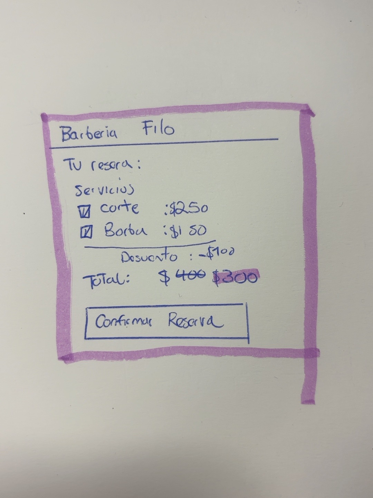

# 4. Refinamiento y escenarios

> Ejercicio 4 · Tema 7 · 🎩 PO y 🎩 desarrollador
> Los escenarios BDD van en la carpeta `features/`.

## 4.1 Pesar (MoSCoW)

Criterio que usé:

Las historias relacionadas con las reglas principales R1 y R2 se clasificaron como Must porque son necesarias para el funcionamiento básico de la aplicación y para el Sprint 1. Las historias de organización y control de agenda se clasificaron principalmente como Should, mientras que funcionalidades menos urgentes o épicas completas quedaron como Could o Won't para este sprint.

## 4.2 Ilustrar

Historia: #5 — HU: Ver el total antes de confirmar la reserva

Boceto:

El boceto muestra una propuesta sencilla de la pantalla donde el cliente puede revisar los servicios seleccionados y el total antes de confirmar su reserva.

## 4.3 Medir

Escala de puntos: 1, 2, 3, 5, 8, 13, 21.

Los puntos se asignaron en el campo `Puntos` del GitHub Project considerando la dificultad, complejidad y riesgo de cada historia.

Durante la estimación, la historia #6 "Cancelar una cita según el tiempo de anticipación" recibió 13 puntos, mientras que las demás historias quedaron en 5 puntos o menos.

## 4.4 Dividir

- **Velocidades de referencia de mi variante:** 14, 18 y 16 puntos.
- **Operación:** (14 + 18 + 16) / 3 = 16 puntos de velocidad promedio. 16 / 2 = 8 puntos.
- **Carga máxima por historia:** 8 puntos.
- **Historias que rebasan la carga máxima:** #6 — HU: Cancelar una cita según el tiempo de anticipación, con 13 puntos.

| Historia original | Puntos | Subhistorias (issues) | Puntos de cada una | ¿Cómo la partí? |
|---|---:|---|---|---|
| #6 — Cancelar una cita según el tiempo de anticipación | 13 | #15, #16, #17 | 3, 3, 3 | La dividí por los tres rangos de tiempo definidos en R2: cancelación con 24 horas o más, entre 2 y menos de 24 horas, y con menos de 2 horas. |

La historia original #6 quedó cerrada como "dividida" y las tres nuevas historias permanecen abiertas para poder desarrollarse de forma independiente.

## 4.5 Escenarios BDD

Los escenarios BDD de R1 y R2 se encuentran en la carpeta `features/`.

- `features/total.feature` — escenarios de R1: cálculo del total del servicio.
- `features/cancelacion.feature` — escenarios de R2: cálculo del cargo por cancelación.

Los escenarios están escritos en formato Dado-Cuando-Entonces y utilizan tablas de Ejemplos con valores límite.

Para R1 se incluyen casos de corte, barba, servicio combinado y el límite entre 4 y 5 visitas mensuales para aplicar el descuento de cliente frecuente.

Para R2 se incluyen los límites de 24 horas y 2 horas, además del caso de no-show.

## 4.6 R2 como tabla FIT

> Escríbela antes de programar. Al terminar el Ejercicio 6, agrega la columna "Resultado real" y marca cada fila: ✅ si pasó, ❌ si falló (con el valor esperado y el real).

| Total de la cita | Horas de anticipación | No-show | Resultado esperado | Resultado real |
|---:|---:|---|---:|---|
| 200 | 48 | No | $0 | — |
| 200 | 24 | No | $0 | — |
| 200 | 23 | No | $100 | — |
| 200 | 2 | No | $100 | — |
| 200 | 1 | No | $200 | — |
| 200 | — | Sí | $200 | — |

La columna "Resultado real" se completará después de ejecutar las pruebas del Ejercicio 6.
